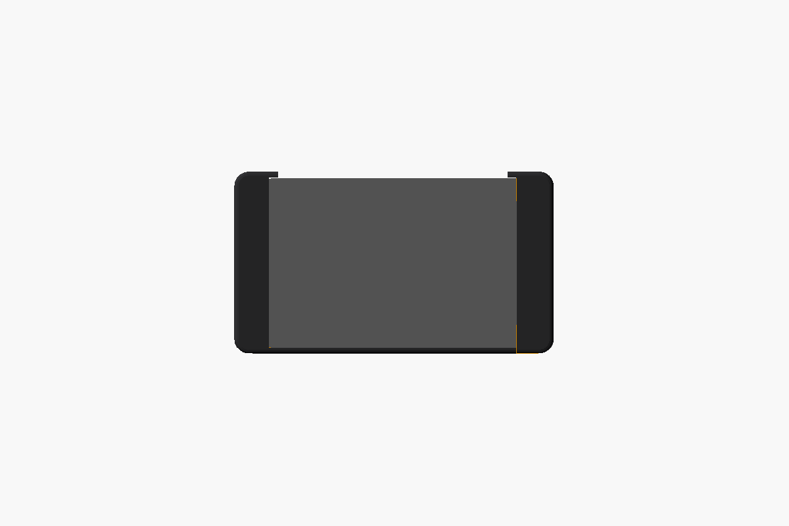
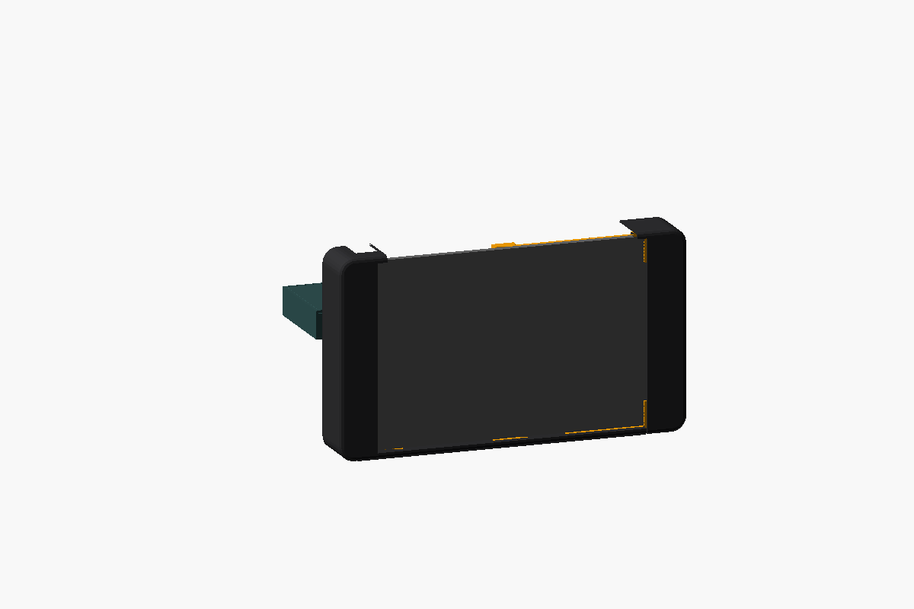
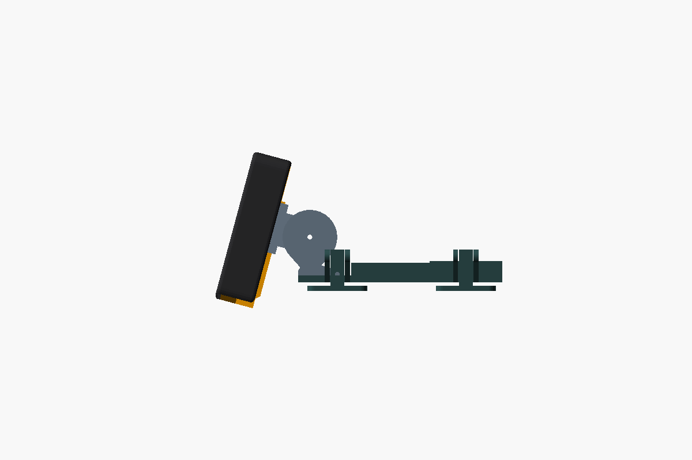
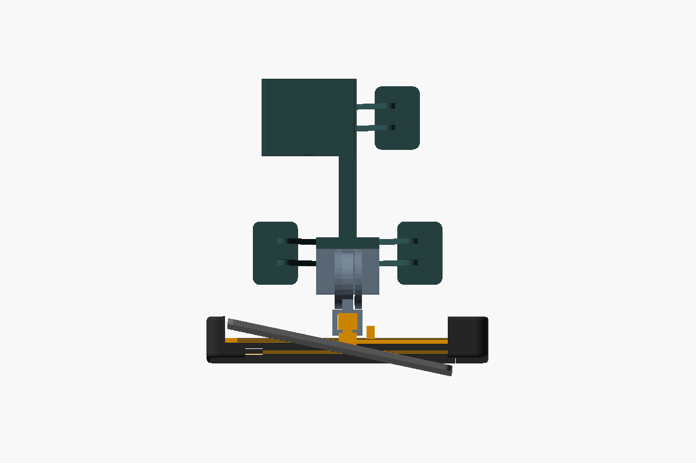
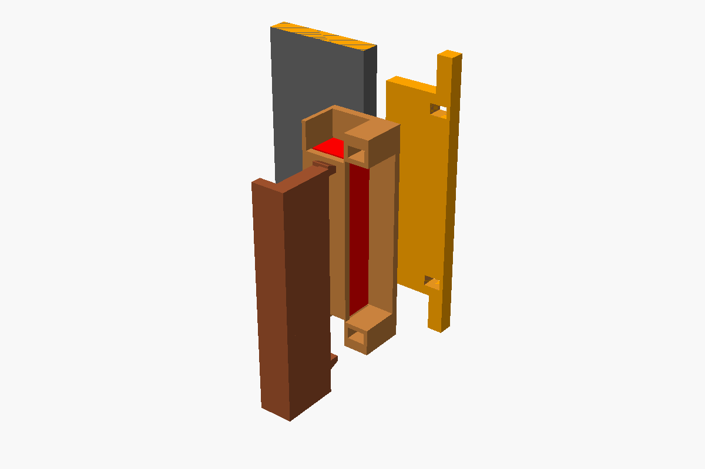

# Parametric car tablet dock

OpenSCAD prototype of a dashboard dock for a bare Samsung Galaxy Tab S7 (SM-T875) in landscape, USB-C on the occupant's right. The tablet slides left to unplug, tilts (left edge inward), and lifts out. Height adjusts 50 mm and pitch ±15° in 5° steps; three standard tape feet adjust ±15° in two axes. Both owned connectors (Essager 90° USB-C cable, CableCreation CD0700 adapter) fit interchangeable inserts under one cover.

At the lowest height the screen hangs in front of the dashboard nose with its bottom edge below the tape faces (29 mm at the nominal pitch, at least 5 mm at every pitch index). A rounded housing with an open back covers the front and sides, and the post, carriage and base stay hidden behind the screen in the occupant view. The height slide therefore sits behind the tablet: a short post carries the pitch fork, and the cradle's rail slides in the pitch carriage.

Because the screen hangs ahead of the front feet, the dock on its own tips forward and would pull on its tape all the time. A tail behind the bridge carries a third foot toward the windshield and a lidded tray beside it for weights. About 495 g of weights at the default 150 mm tail leaves every pad pressed down at rest. Weights cost less than printed length, so the tail is short and the tray roomy; no printed part is meant to act as weight. Nothing but tape touches the car, so the tail length (`rear_reach`) is the only setting that depends on the dashboard's depth.

The only screws are eight identical M5 × 35 bolts, on the joints that are set and then locked: height, pitch and the six foot pivots. The post prints as part of the bridge, the connector cover and the end cap clip on with printed tongues, and the tray lid slides under lips.

**Status: unqualified prototype.** The geometry checks pass for the declared, mostly unmeasured inputs. Nothing has been printed, fitted, loaded, heated, bonded or driven. This is not a production-ready, universal-fit, damage-free-removal, crash-safe or road-qualified design. Crash retention is not designed or tested: in a collision the tablet or dock may detach and strike occupants. Without the weights in the tray the rear foot's tape is pulled upward all the time, even when parked; the weights are set by a balance check, not by a rating (see Assembly and docs/measurements.md). See [docs/validation.md](docs/validation.md) for what is and is not established.

## Renderings

OpenSCAD previews of the current model (provisional geometry, nominal tablet), in `docs/images/`.

| | |
|---|---|
|  Occupant view (Front view): housing, screen and nothing else; USB-C on the right |  Housing from above the driver's side; the top edge stays open for removal |
|  Front three-quarter view |  Rear: rail, carriage, and the bridge with its post, tail, weight tray and three feet |
|  Right side: 0 mm height, -15° pitch; the screen hangs below the tape faces, ahead of the feet |  Right side: 0 mm height, +15° pitch; the bottom edge is still 7 mm below the tape faces |
|  Right side: 50 mm height, +15° pitch |  Feet at opposite ±15° corners |
|  Removal 1: slide 8 mm left, plug out |  Removal 2 (top view): left edge inward 12° |
|  Removal 3: lift clear |  Motion sample with its surrogate |
|  CD0700 bay, exploded: tablet edge, rear mount, insert with the connector, and the cover whose two tongues pass through both and hook behind the mount |  The same with the Essager insert |

## Files

| Path | Contents |
|---|---|
| `cad/parameters.scad` | Every dimension, limit and clearance; provisional values are marked |
| `cad/dock.scad` | Geometry, assembly poses, bed orientations and the `part` selector |
| `export.py` | Regenerates every STL, clearance variant, preview and `manifest.json` |
| `tests/geometry_checks.scad` | Spatial fixtures for allowed motion, forbidden motion and keep-outs |
| `tests/test_geometry.py` | Runs OpenSCAD on each fixture and part |
| `docs/measurements.md` | Source and status of each input; hardware; mass and lever arms |
| `docs/validation.md` | Digital checks, their limits, physical protocols and qualification status |
| `docs/superpowers/` | Approved design brief and implementation plan |

## Setup and checks

Requires OpenSCAD 2021.01 and Python 3 (standard library only). From WSL:

```
python3 -m unittest discover -s tests -v
```

The suite takes about five minutes and runs renders in parallel within available memory. `test_declared_build_volume` is skipped until the print service's usable volume is entered in `build_volume`.

## Preview and controls

Open `cad/dock.scad` in OpenSCAD; the Front view is the occupant view. Override controls with `-D`:

| Control | Range | Meaning |
|---|---|---|
| `part` | see below | What to render; default `assembly` |
| `connector` | `"essager"`, `"cd0700"` | Which insert and connector to show or export |
| `height_mm` | 0–50 | Locked height, along the cradle's own vertical (tilts with pitch) |
| `pitch_deg` | -15 to 15, multiples of 5 | Locked pitch from the nominal angle; + turns the screen toward the roof |
| `slide_mm`, `release_yaw_deg`, `lift_mm` | ≥ 0 | Removal poses: slide left, tilt the left edge inward, lift |
| `foot_pitch`, `foot_roll` | `[left, right, rear]`, ±15 each | Foot angles to match the dashboard slope |
| `rear_reach` | ≥ 87.5, default 150 | Rear foot and weight tray behind the front feet; a longer tail needs fewer weights, a shorter one more |

Example: `openscad -D height_mm=50 -D pitch_deg=15 -D slide_mm=8 -D release_yaw_deg=12 cad/dock.scad`

Invalid values (out of range, off the pitch index, unknown `part` or `connector`, too little slide overlap) stop the render with an assertion message.

## Printed parts

Export every part in its candidate bed orientation, plus the 0.3 / 0.5 / 0.7 mm clearance variants of the inserts, cover and motion sample, previews and `manifest.json`:

```
python3 export.py   # writes build/prototype/ (git-ignored); previews need xvfb-run
```

Each STL must render without diagnostics, form one connected solid and rest on Z=0, or the script stops. `manifest.json` records the source revision (none if the tree is dirty), source hashes, OpenSCAD version, every `-D` override, and each STL's bounds and hash.

| Part | Qty | Size on bed (mm) | Orientation |
|---|---|---|---|
| `cradle` (with the left cap and chin of the housing) | 1 | 305.8 × 51.0 × 177.8 | Floor down |
| `end_cap` (right end of the housing) | 1 | 177.4 × 45.8 × 44.8 | Outer side down; its two tongues need light support |
| `insert` (`essager`, `cd0700`) | 1 each | 66.5 × 14.1 × 22.5 | Entry side down |
| `cover` | 1 | 66.5 × 25.6 × 10.8 | Side plate down; its two tongues need light support |
| `carriage` | 1 | 33.6 × 90.4 × 60.0 | Upright; the lug disc below its web needs support |
| `bridge` (with the post, tail and weight tray) | 1 | 173.0 × 256.5 × 84.7 | Plate down; the arm bosses need support |
| `ballast_lid` | 1 | 102.0 × 82.2 × 2.5 | Flat, wide face down |
| `foot_yoke` | 3 | 30.0 × 37.0 × 16.0 | On its side |
| `tape_foot` | 3 | 50.0 × 70.0 × 27.0 | Tape face down; keep it flat |

The cradle needs a bed of at least about 306 × 51 mm and 178 mm of height. Do not split it until the service states its usable volume; then choose splits away from the hooks, roofs, detent and rail, and recheck the joint. The bridge is the base part on the dashboard, not a tablet holder; its length is the tail plus the post's fork, which overhangs the plate's front by 18 mm (106.5 mm plus `rear_reach`). At the default it is 0.5 mm longer than a 256 mm bed: place it diagonally or use `rear_reach=149`. The base needs about 230 mm of dashboard top behind the front pads' front edge at the default. Each 50 mm of tail is about 23 g of solid plastic; it saves about 330 g of weights between 100 and 150 mm and about 170 g between 150 and 200 mm (see Assembly).

Fit and mechanism samples, to print first: `motion_sample` with `surrogate`, `fit_sample` with both inserts and the cover, `slide_sample` (a cradle rail coupon) with `carriage`, and `pitch_joint` (the carriage lug coupon) with `post` (the fork alone, so the pitch joint can be tried without printing the bridge). Variants and procedures are in [docs/validation.md](docs/validation.md).

### Printing notes for the service review

- Material: PLA for indoor fit samples only; PETG for mechanism samples; ABS is the proposed final material, subject to the actual filament and to heat testing. Ask for warp control on the large flat parts.
- Check every STL in the service's slicer for defects, supports and printable features. STL export is not mesh or manufacturing qualification.
- Weak layer directions to review: the carriage sleeve and the cradle's rail carry the fore/aft moment across their layers when printed upright; the post's fork cheeks and the bridge arms bend partly across layers. Use ordinary infill everywhere: no printed part is meant to act as weight, and the balance check in Assembly makes up for whatever the print weighs. The face teeth (1.6–2.4 mm pitch, 0.8–1.2 mm deep) are near FDM resolution.
- Supports in these orientations: the cradle's left, right and hook roofs and the top-right rear rail need support underneath (the roofs are capture faces; remove scars); the housing's top skin bridges about 15 mm over the left cap's cavity, and its rounded bottom edges and the end cap's rounded bed edges need light support; the carriage's lug disc needs support below its web. The rail's underside slopes into its web for printing. The detent tongue overhangs its slot 4 mm above the bed; the slot is open below, so its support comes out from underneath, and the tongue must not fuse to it. The rear-contact faces, insert seat, slide faces and toothed faces print as walls without support.
- Snap tongues: two on the cover and two on the end cap, 1.8 × 5 mm and about 19 mm long. In these orientations they bend within their layers, so do not reorient these two parts; the tongues hang free above the bed and need light support. Fitting bends each one about 1.1 mm once (under 1 % strain); seated, they carry no load. The tray's lips lean in about 28° and print without support.
- Clearances (0.5 rail, 0.5 insert, 0.3 slide, 0.3 tongue windows and lid, 0.2 tooth play, 0.5 housing) are print allowances to tune with the samples.
- Housing finish: the front and side faces are the visible surfaces; sand and paint them for the OEM look. Keep the left lip's and hooks' inner edges, which the tablet touches, unpainted.

## Hardware

Ordinary steel or stainless metric hardware; verify every size on a coupon.

| Item | Qty | Use |
|---|---|---|
| M5 × 35 socket head (ISO 4762) | 8 | Pitch joint (1), height clamp (1), foot pivots (6) |
| DIN 934 M5 nut | 8 | One per bolt, in captive pockets |
| DIN 125 M5 washer (10 OD × 1) | 20 | Under each bolt head (8) and in the twelve 1 mm foot-pivot gaps (12) |
| Weights: steel stick-on wheel weights (5 g segments) or any dense filler | about 495–535 g at the default tail | Weight tray, 100 × 80 × 20 mm inside (roughly 750 g of wheel weights or 1.2 kg of solid steel) |

That is the whole screw list: one bolt size, one nut, one washer. The eight bolts sit on the joints that are set and then locked. A lock has to keep squeezing, and plastic under constant stress relaxes in a hot car, so those joints keep metal bolts. Everything else holds by shape: the post is part of the bridge print, the cover and end cap clip on with tongues that are relaxed once seated, and the tray lid slides under lips. `validate()` rejects a clamped joint too wide for the M5 × 35.

Tape: not selected. Choose the grade with its supplier for the printed surface and the actual dashboard material.

## Assembly

1. Fit the twelve gap washers and assemble each of the three feet: pad lug into the yoke (lower bolt, head outboard), yoke between its two arms on the bridge or tail (upper bolt, head at the front). The rear foot is a right foot.
2. Stand the base on the chosen surface without tape, with the pads behind the dashboard's front edge so the screen can hang in front of it. Set all three feet so each pad lies flat with no rocking, then tighten the six pivot bolts. The base then follows the dashboard's slope from front to rear; correct the screen angle with the pitch index. The plate, tail and tray sit 10 mm above the pad plane and must not touch the dashboard. The feet must be set with the cradle off; check driver sightline, vents, controls and airbag covers before going further.
3. Slide the carriage down onto the cradle's rail from above and fit the clamp bolt through the slot (it also stops travel; keep it fitted). Set the height and tighten.
4. Place the carriage lug between the post's fork cheeks, fit the pitch bolt, choose an index and tighten.
5. With the tablet removed, slide the unpowered connector into its insert from the right, place the insert against the rear mount, plug in the downstream cables through the front outlets, and lay the cables in their channels and the cable clip. Push the cover straight back onto the insert until both tongues click behind the rear mount. Leave a cable loop of at least 80 mm between the clip and the post, clear of the carriage and above the tape plane.
6. Push the end cap straight back over the right end until both tongues click behind the hooks.
7. Set the weights before any tape goes on. With the tablet docked at the height and pitch you will use, stand the dock on a table with the front pads at the table's edge and the screen hanging over it. Without weights the rear pad lifts. Add weights to the tray until the dock sits on all three pads on its own, add about 30 g more, then slide the lid in from the front, under the lips, until it clicks behind the bump on the front rim. Pack the weights with foam or tape so they cannot move or rattle. Expect about 495 g at the default 150 mm tail (535 g at full height and -15° pitch), about 320 g at 200 mm and about 825 g at 100 mm (more than the tray holds in wheel weights; use solid steel or lead), for solid prints and a 500 g tablet. Lighter infill needs a little more. Repeat the check after changing height, pitch, tablet or connector.
8. Only after the fit, load and heat checks in docs/validation.md pass, bond the pads with the selected tape following its surface preparation, pressure and dwell instructions.

**Install the tablet:** place it tilted (left edge inward) into the cradle, press the right edge inward until it is flat against the guides, then slide right to engage USB-C and the detent.

**Remove the tablet:** slide left against the detent until USB-C is out and the tablet reaches the left wall, press the left edge inward (the right edge swings about 25 mm outward), then lift. Do not adjust or remove the tablet while driving.

**Adjust height:** loosen the clamp bolt on the carriage, slide the cradle along the rail within the slot, retighten. Height moves along the screen's own vertical, so at ±15° pitch it also moves the screen about 13 mm fore/aft.

**Adjust pitch:** unloaded, loosen the pitch bolt, spread the toothed cheek about 1.2 mm so the teeth clear, turn to the next 5° index, reseat and tighten. Never force the joint across engaged teeth.

**CD0700 cables:** plug and unplug its downstream cables only with the tablet removed. Its body is held along that axis only by its own plug shell (an open gate in docs/validation.md), so doing it with the tablet docked loads the tablet's port.

**Swap connector:** with the tablet removed, reach behind the right hooks, press the end cap's two barbs toward the middle and pull the cap forward. Release the cover the same way behind the rear mount. Unplug the downstream cables, slide the connector out, fit the other insert and connector, then reassemble as in steps 5 and 6.

**Open the weight tray:** lift the lid's front edge over the bump with a fingernail and slide it forward.

## Handoff record

With every delivered prototype, keep the `manifest.json` from `python3 export.py` (source revision, every `-D` override and hash per STL), and record the measurement assumptions in docs/measurements.md, the hardware list, the filament grade and batch, printer, nozzle, layer height, walls, infill, orientation, supports and post-processing. Physical results go into docs/validation.md as pass, fail or UNRUN.
