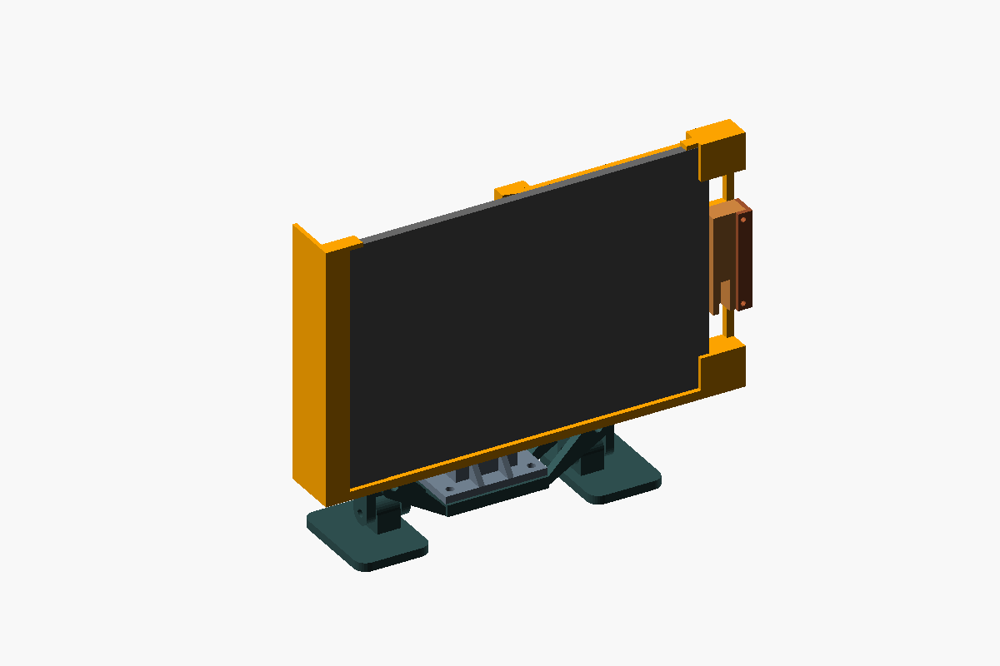
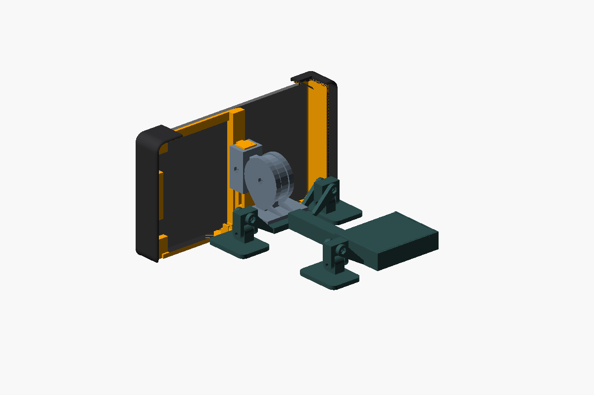
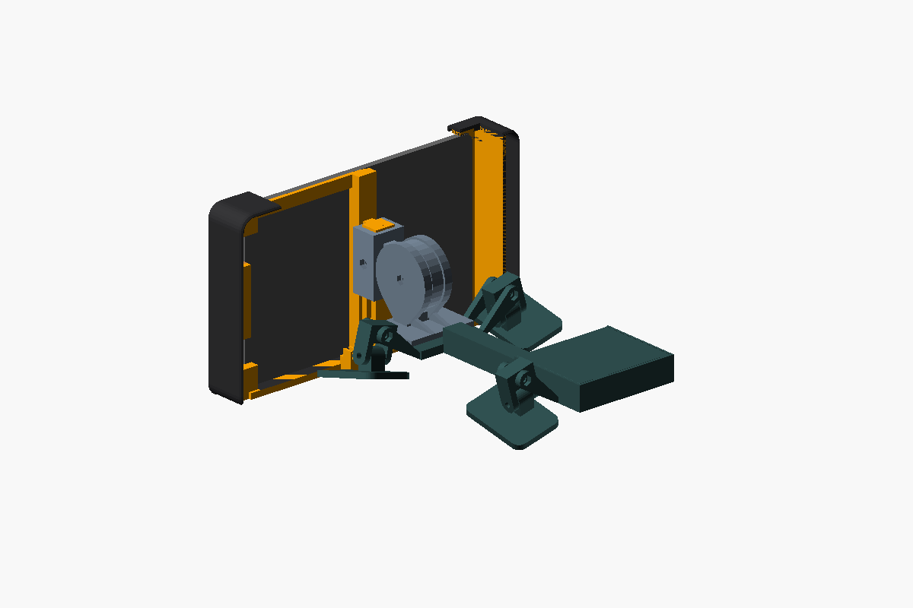
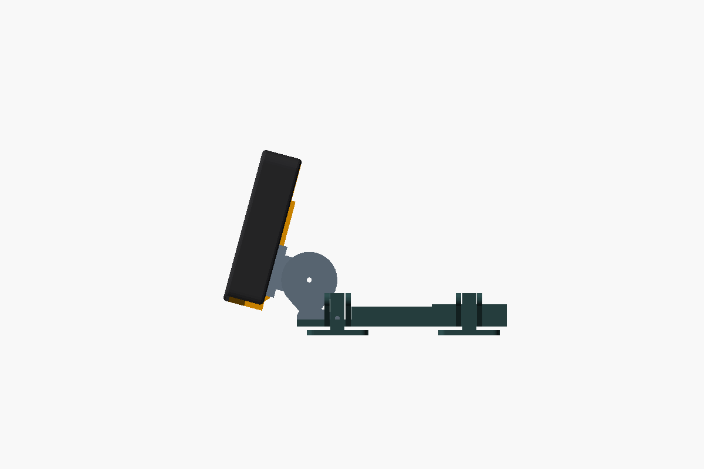
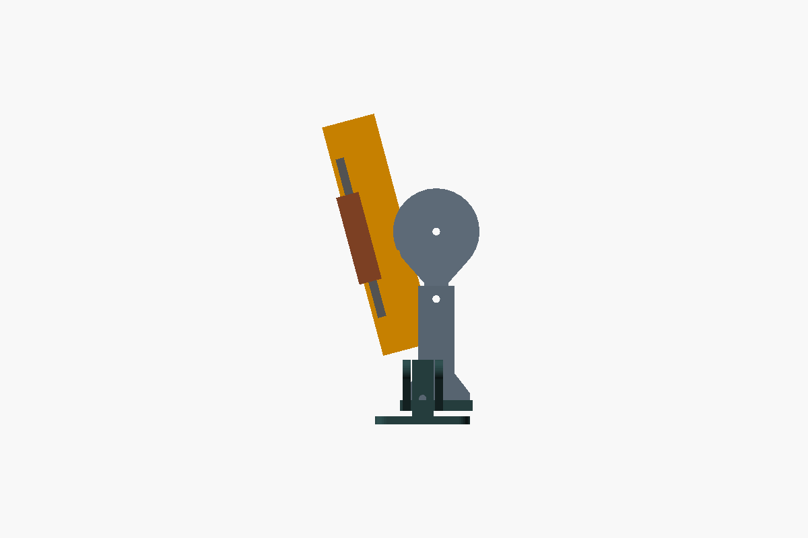
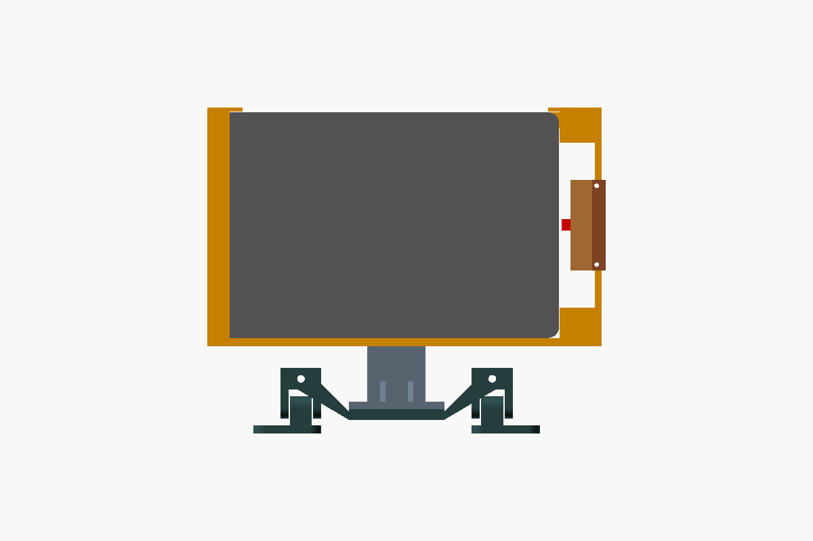
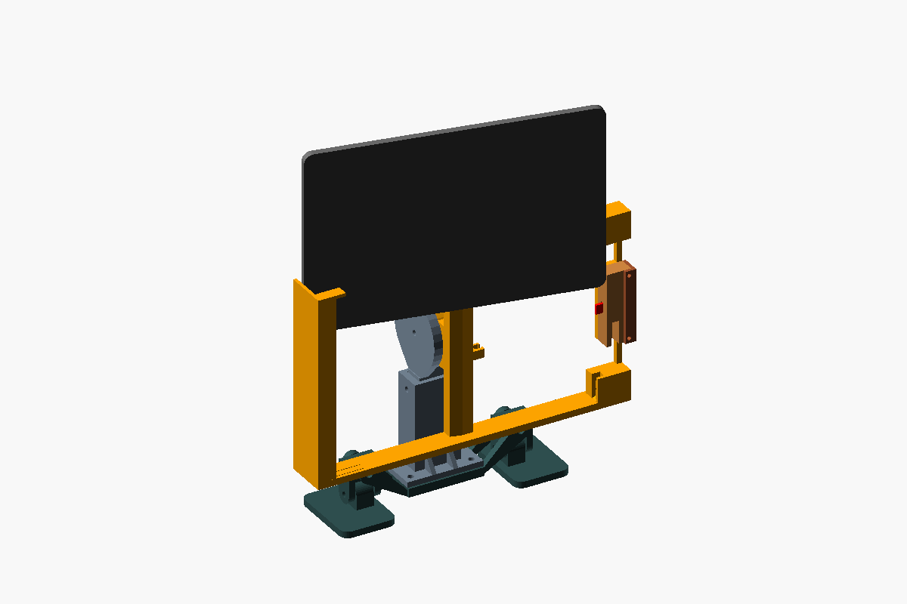
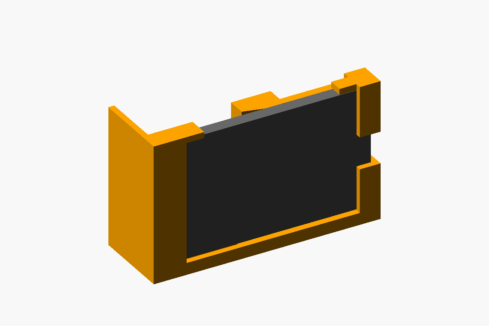
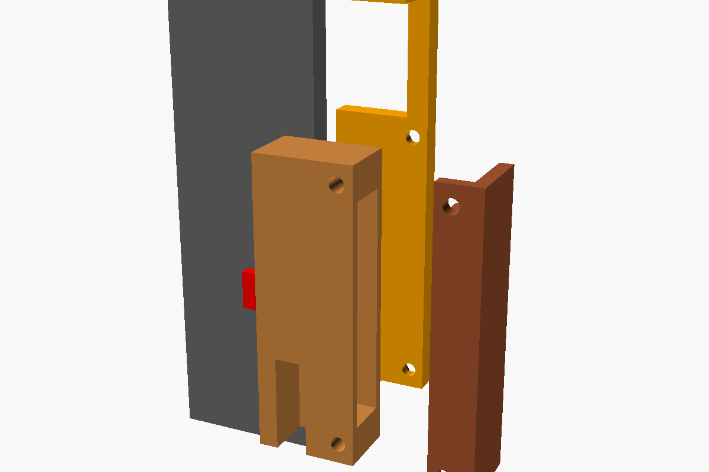

# Parametric car tablet dock

OpenSCAD prototype of a dashboard dock for a bare Samsung Galaxy Tab S7 (SM-T875) in landscape, USB-C on the occupant's right. The tablet slides left to unplug, tilts (left edge inward), and lifts out. Height adjusts 50 mm and pitch ±15° in 5° steps; two standard tape feet adjust ±15° in two axes. Both owned connectors (Essager 90° USB-C cable, CableCreation CD0700 adapter) fit interchangeable inserts under one cover.

**Status: unqualified prototype.** The geometry checks pass for the declared, mostly unmeasured inputs. Nothing has been printed, fitted, loaded, heated, bonded or driven. This is not a production-ready, universal-fit, damage-free-removal, crash-safe or road-qualified design. Crash retention is not designed or tested: in a collision the tablet or dock may detach and strike occupants. See [docs/validation.md](docs/validation.md) for what is and is not established.

## Renderings

OpenSCAD previews of the current model (provisional geometry, nominal tablet), in `docs/images/`.

| | |
|---|---|
|  Occupant view (Front view), USB-C on the right |  Front three-quarter view |
|  Rear: spine, pitch joint, mast, bridge and feet |  Feet at opposite ±15° corners |
|  Right side: 50 mm height, +15° pitch |  Right side: 0 mm height, -15° pitch |
|  Removal 1: slide 8 mm left, plug out |  Removal 2 (top view): left edge inward 12° |
|  Removal 3: lift clear |  Motion sample with its surrogate |
|  CD0700 insert, cover and rear mount, exploded |  Essager insert with its downward cable channel |

## Files

| Path | Contents |
|---|---|
| `cad/parameters.scad` | Every dimension, limit and clearance; provisional values are marked |
| `cad/dock.scad` | Geometry, assembly poses, bed orientations and the `part` selector |
| `export.py` | Regenerates every STL, clearance variant, preview and `manifest.json` |
| `tests/geometry_checks.scad` | Spatial fixtures for allowed motion, forbidden motion and keep-outs |
| `tests/test_geometry.py` | Runs OpenSCAD on each fixture and part |
| `docs/measurements.md` | Source and status of each input; hardware; mass and lever arms |
| `docs/validation.md` | Digital checks, their limits, physical protocols and qualification status |
| `docs/superpowers/` | Approved design brief and implementation plan |

## Setup and checks

Requires OpenSCAD 2021.01 and Python 3 (standard library only). From WSL:

```
python3 -m unittest discover -s tests -v
```

The suite takes about five minutes and runs renders in parallel within available memory. `test_declared_build_volume` is skipped until the print service's usable volume is entered in `build_volume`.

## Preview and controls

Open `cad/dock.scad` in OpenSCAD; the Front view is the occupant view. Override controls with `-D`:

| Control | Range | Meaning |
|---|---|---|
| `part` | see below | What to render; default `assembly` |
| `connector` | `"essager"`, `"cd0700"` | Which insert and connector to show or export |
| `height_mm` | 0–50 | Locked height |
| `pitch_deg` | -15 to 15, multiples of 5 | Locked pitch from the nominal angle; + turns the screen toward the roof |
| `slide_mm`, `release_yaw_deg`, `lift_mm` | ≥ 0 | Removal poses: slide left, tilt the left edge inward, lift |
| `foot_pitch`, `foot_roll` | `[left, right]`, ±15 each | Foot angles to match the dashboard slope |

Example: `openscad -D height_mm=50 -D pitch_deg=15 -D slide_mm=8 -D release_yaw_deg=12 cad/dock.scad`

Invalid values (out of range, off the pitch index, unknown `part` or `connector`, too little slide overlap) stop the render with an assertion message.

## Printed parts

Export every part in its candidate bed orientation, plus the 0.3 / 0.5 / 0.7 mm clearance variants of the inserts, cover and motion sample, previews and `manifest.json`:

```
python3 export.py   # writes build/prototype/ (git-ignored); previews need xvfb-run
```

Each STL must render without diagnostics, form one connected solid and rest on Z=0, or the script stops. `manifest.json` records the source revision (none if the tree is dirty), source hashes, OpenSCAD version, every `-D` override, and each STL's bounds and hash.

| Part | Qty | Size on bed (mm) | Orientation |
|---|---|---|---|
| `cradle` | 1 | 288.3 × 91.6 × 174.8 | Floor down |
| `insert` (`essager`, `cd0700`) | 1 each | 66.5 × 14.1 × 22.5 | Entry side down |
| `cover` | 1 | 66.5 × 17.1 × 10.8 | Side plate down |
| `mast_outer` | 1 | 70.0 × 50.0 × 84.7 | Flange down |
| `mast_inner` | 1 | 31.2 × 64.0 × 150.6 | Upright, tongue down; use a brim |
| `bridge` | 1 | 156.0 × 54.0 × 38.0 | Plate down; the arm bosses need support |
| `foot_yoke` | 2 | 30.0 × 37.0 × 16.0 | On its side |
| `tape_foot` | 2 | 50.0 × 70.0 × 27.0 | Tape face down; keep it flat |

The cradle needs a bed of at least about 290 × 92 mm and 175 mm of height. Do not split it until the service states its usable volume; then choose splits away from the hooks, roofs, detent and lug, and recheck the joint.

Fit and mechanism samples, to print first: `motion_sample` with `surrogate`, `fit_sample` with both inserts and the cover, `slide_sample` with `mast_inner`, and `pitch_joint` (the cradle lug coupon). Variants and procedures are in [docs/validation.md](docs/validation.md).

### Printing notes for the service review

- Material: PLA for indoor fit samples only; PETG for mechanism samples; ABS is the proposed final material, subject to the actual filament and to heat testing. Ask for warp control on the large flat parts.
- Check every STL in the service's slicer for defects, supports and printable features. STL export is not mesh or manufacturing qualification.
- Weak layer directions to review: the mast sleeve and tongue carry the fore/aft moment across their layers when printed upright; the bridge arms bend partly across layers. The face teeth (1.6–2.4 mm pitch, 0.8–1.2 mm deep) are near FDM resolution.
- Supports in these orientations: the cradle's left, right and hook roofs, the top-right rear rail, the lug web and the cable clip need support underneath (the roofs are capture faces; remove scars). The detent tongue overhangs its slot 4 mm above the bed; the slot is open below, so its support comes out from underneath, and the tongue must not fuse to it. The rear-contact faces, insert seat, slide faces and toothed faces print as walls without support.
- Clearances (0.5 rail, 0.5 insert, 0.3 slide, 0.2 tooth play) are print allowances to tune with the samples.

## Hardware

Ordinary steel or stainless metric hardware; verify every size on a coupon.

| Item | Qty | Use |
|---|---|---|
| M3 × 25 socket head, ISO 4032 M3 nut | 2 | Insert and cover to the cradle |
| M5 × 35 socket head | 5 | Pitch joint (1), foot pivots (4) |
| M5 × 45 socket head | 1 | Height clamp |
| M5 × 16 socket head | 4 | Mast flange to bridge |
| DIN 934 M5 nut | 10 | All M5 bolts (captive pockets) |
| DIN 125 M5 washer (10 OD × 1) | 18 | Under each pitch, clamp, foot and flange bolt head (10), and in the eight 1 mm foot-pivot gaps (8) |

Tape: not selected. Choose the grade with its supplier for the printed surface and the actual dashboard material.

## Assembly

1. Fit the eight gap washers and assemble each foot: pad lug into the yoke (lower M5 × 35, head outboard), yoke between the bridge arms (upper M5 × 35, head at the front).
2. Bolt the outer mast to the bridge (4 × M5 × 16, nuts from below).
3. Stand the base on the chosen surface without tape. Set both feet so each pad lies flat with no rocking, then tighten the four pivot bolts. The feet must be set with the cradle off; check driver sightline, vents, controls and airbag covers before going further.
4. Slide the inner mast into the sleeve and fit the clamp bolt through the slot (it also stops travel; keep it fitted). Set the height and tighten.
5. Place the cradle lug between the fork cheeks, fit the pitch bolt, choose an index and tighten.
6. With the tablet removed, slide the unpowered connector into its insert from the right, place the insert against the rear mount, plug in the downstream cables through the front outlets, lay the cables in their channels and the cable clip, and fit the cover with two M3 × 25 bolts.
7. Only after the fit, load and heat checks in docs/validation.md pass, bond the pads with the selected tape following its surface preparation, pressure and dwell instructions.

**Install the tablet:** place it tilted (left edge inward) into the cradle, press the right edge inward until it is flat against the guides, then slide right to engage USB-C and the detent.

**Remove the tablet:** slide left against the detent until USB-C is out and the tablet reaches the left wall, press the left edge inward (the right edge swings about 25 mm outward), then lift. Do not adjust or remove the tablet while driving.

**Adjust height:** loosen the clamp bolt, move the mast within the slot, retighten.

**Adjust pitch:** unloaded, loosen the pitch bolt, spread the toothed cheek about 1.2 mm so the teeth clear, turn to the next 5° index, reseat and tighten. Never force the joint across engaged teeth.

**CD0700 cables:** plug and unplug its downstream cables only with the tablet removed. Its body is held along that axis only by its own plug shell (an open gate in docs/validation.md), so doing it with the tablet docked loads the tablet's port.

**Swap connector:** with the tablet removed, take out the two M3 bolts and the cover, unplug the downstream cables, slide the connector out, fit the other insert and connector, then reassemble as in step 6.

## Handoff record

With every delivered prototype, keep the `manifest.json` from `python3 export.py` (source revision, every `-D` override and hash per STL), and record the measurement assumptions in docs/measurements.md, the hardware list, the filament grade and batch, printer, nozzle, layer height, walls, infill, orientation, supports and post-processing. Physical results go into docs/validation.md as pass, fail or UNRUN.
